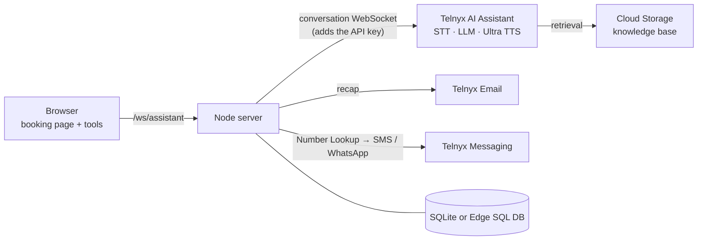

# TelnyxHotel: a multilingual AI voice receptionist built on Telnyx

[](https://github.com/team-telnyx/telnyx-demo-hotel/releases)
[](package.json)
[](LICENSE)
[](https://nodejs.org)
[](https://expressjs.com)
[](https://github.com/websockets/ws)
[](https://nodejs.org/api/sqlite.html)
[](https://developers.telnyx.com/docs/inference/ai-assistants)
[](https://developers.telnyx.com/docs/voice/tts)
[](https://developers.telnyx.com/docs/messaging)
[](https://developers.telnyx.com/docs/email)
[](https://developers.telnyx.com/docs/edge-compute)
[](test/security.test.js)

Guests book a room by **talking to the front desk**. A Telnyx AI Assistant answers in English, French, German, Italian, Spanish or Dutch, fills in the booking while the guest speaks, checks availability, confirms, and sends the confirmation by e-mail, SMS or WhatsApp. A small Node backend keeps the Telnyx API key on the server, records every call end to end and comes with an admin back office.

> **TelnyxHotel is fictional**: hotels, prices, availability and knowledge base are invented; photos are freely licensed ([credits](public/assets/CREDITS.md)).

**New to Telnyx?** [Create an account](https://telnyx.com/sign-up) and build the same on [AI Assistants](https://developers.telnyx.com/docs/inference/ai-assistants), [Voice](https://developers.telnyx.com/docs/voice/tts), [Messaging](https://developers.telnyx.com/docs/messaging), [Email](https://developers.telnyx.com/docs/email), [Number Lookup](https://developers.telnyx.com/docs/identity/number-lookup), [Cloud Storage](https://developers.telnyx.com/docs/cloud-storage/quick-start) and [Edge Compute](https://developers.telnyx.com/docs/edge-compute).

## Features

- **Booking** (`/`): hotel site with a voice concierge; the guest picks a language and a Telnyx Ultra voice, talks or types, and the page follows the spoken language.
- **How it works** (`/flow.html`): animated architecture, step by step; live while a call runs in another tab.
- **Call history** (`/history.html`): setup waterfall, conversation with per-turn latency, tool calls, events, and the guest messages each call sent.
- **Back office** (admins): Users & access, Guest stats, AI Assistant (languages, voices, prompt, knowledge base, video avatar), E-mail, SMS / WhatsApp.
- **Guest access**: *Try it as a guest* on the login page, no account needed (English only, nothing sent to the guest).
- **Guest stats** (`/guests.html`, admins): understand how guests use the demo (calls by hour and weekday, a world map by country, booking rate and where unbooked calls stopped, Telnyx conversation insights per call) monitor the app's traffic on Telnyx Edge (requests, errors, latency), and follow up with the guests who asked to be contacted: a follow-up e-mail template edited on the page (live preview), sent with Telnyx Email from each contact's row, which is then marked as e-mailed.
- A collapsible **help column** on every page, and a footer with **Frontend · Backend · Branch** versions.

## Quick start

Requirements: **Node.js 22.5+** and a Telnyx **API key** ([Portal → API Keys](https://portal.telnyx.com/#/api-keys)).

```bash
git clone https://github.com/team-telnyx/telnyx-demo-hotel.git
cd telnyx-demo-hotel
npm install
cp .env.example .env    # set TELNYX_API_KEY (or let setup ask for it)
npm run setup           # creates the knowledge base and the AI Assistant, completes .env
npm run geo:update      # optional: country data for the Guest stats map
npm start               # http://localhost:3000
```

Setup prints the admin login. Sign in, open **Booking**, press *Book with your voice* and talk (headphones help). Turn on guest confirmations in **E-mail** and **SMS / WhatsApp**; until then the recap is an in-browser preview. The microphone needs `localhost` or HTTPS.

## Create the AI Assistant on Telnyx

### `npm run setup` (recommended)

| Step | What it does |
|---|---|
| 1 | Checks Node.js and creates `.env` from `.env.example` if missing. |
| 2 | Verifies `TELNYX_API_KEY` with a read-only call. |
| 3 | Creates a Cloud Storage bucket (unique name), uploads `kb/*.txt` and waits for the embeddings. |
| 4 | Creates the assistant from `assistant/assistant.json` + `assistant/instructions.md`, or updates the one in `TELNYX_ASSISTANT_ID`. |
| 5 | Writes `TELNYX_ASSISTANT_ID`, `KB_BUCKET` and, when unset, `SESSION_SECRET` and the first admin. |

It is safe to re-run. `-- --dry-run` shows the plan without writing anything; `-- --force` overwrites a live assistant edited in the app.

The assistant: model `moonshotai/Kimi-K2.6`, Deepgram Flux transcription (automatic language), a Telnyx Ultra voice, and these tools:

| Tool | Runs in | Purpose |
|---|---|---|
| `update_booking` | browser | Fills the booking (hotel, dates, guests, room, name, e-mail, mobile, requests); returns what is missing. |
| `check_availability` | browser | Rooms and nightly prices for a stay. |
| `confirm_booking` | browser | Validates and returns a code; the page sends the e-mail and SMS / WhatsApp. |
| `retrieval` | Telnyx | Searches the hotel knowledge base. |
| `hangup` | Telnyx | Ends the call after the goodbye. |

Later: `npm run assistant:sync` pushes `assistant/` (`-- --pull` brings live edits back), `npm run kb:sync` uploads changed `kb/` files.

### By hand, in the Telnyx Portal

1. **Storage**: create a bucket, upload `kb/*.txt`, enable embeddings for it.
2. **AI Assistants → Create**: paste `assistant/instructions.md`, model `moonshotai/Kimi-K2.6`, transcription Deepgram Flux (auto), any Ultra voice, greeting `{{greeting}}`.
3. Tools: **Retrieval** (your bucket), **Hangup**, and the three client-side tools above, with descriptions and parameters from `assistant/assistant.json`.
4. Put the assistant id in `.env` as `TELNYX_ASSISTANT_ID` and the bucket as `KB_BUCKET`.

## How it works



- The browser talks only to the server, which opens the Telnyx [conversation WebSocket](https://developers.telnyx.com/docs/inference/ai-assistants/realtime-conversations) with the key and relays the frames.
- The guest's language and voice are a per-user preference cookie (`/api/prefs`). Telnyx takes the voice from the assistant, so the server sets it before each call, under a lock, and only from the admin's shortlist.
- Booking tools run in the page; the server re-validates every booking before sending anything.
- The server records every call (`calls.js`) for the history page.

## Configuration

`.env` locally ([`.env.example`](.env.example)); on Telnyx Edge, account secrets prefixed `TELNYXHOTEL_`.

| Variable | Purpose |
|---|---|
| `TELNYX_API_KEY` | Telnyx API key (required). |
| `TELNYX_ASSISTANT_ID` | The AI Assistant (written by setup). |
| `KB_BUCKET`, `KB_REGION` | Knowledge-base bucket and region. |
| `ADMIN_EMAIL`, `ADMIN_PASSWORD`, `ADMIN_NAME` | First admin, created while there are no users. |
| `SESSION_SECRET` | Signs session cookies. |
| `GUEST_ACCESS` | `off` removes guest access (on by default). |
| `FRAME_ANCESTORS` | Optional comma-separated exact HTTPS origins allowed to embed the app; denied by default. Original sign-in and permissions still apply. |
| `EDGE_FUNCTION` | Edge function whose traffic Guest stats shows (default `telnyxhotel-concierge`). |
| `PORT`, `DATA_DIR` | HTTP port (3000), SQLite location (`./data`). |
| `SQLDB_ID` | Telnyx Edge SQL database (instead of SQLite). |
| `SQLDB_API_KEY` | Optional separate storage-account key; defaults to `TELNYX_API_KEY`. Keeps assistant and messaging resources in their original account. |
| `SMTP_*`, `MAIL_FROM`, `RECAP_OVERRIDE_TO` | Optional SMTP fallback for the recap. |
| `GIT_BRANCH` | Branch shown in the footer when there is no git checkout. |

Languages, voices, e-mail and SMS / WhatsApp setup are edited in the app and stored in the database.

## Access and privacy

- Deny-by-default: everything needs a login except the login page and its assets, `/health`, `/api/version` and the guest sign-in (`/api/auth/guest`).
- **Guests** get a 2-hour session with Booking and How it works only: English only (also enforced on the call), the video avatar when one is set up, and no recap e-mail, SMS or WhatsApp; the page and the receptionist say these come with an account. Guest calls last up to 5 minutes, 3 at a time per instance, 10 guest sessions per hour per IP. Admins see guest calls in Call history (user *Guest*). Guest stats shows calls by country only, worked out on the server from DB-IP country data (`npm run geo:update`, CC BY 4.0); nothing is shared with third parties. Guests also see a pop-up offering to be contacted by Telnyx about TelnyxHotel: an e-mail address and/or phone number is stored only when the guest ticks the consent box and sends it, and admins find it in Guest stats → Contacts (follow-up e-mail, CSV export, delete).
- Admins grant **Booking**, **How it works** and **Call history**; the back office is admin-only.
- Each user sees only their own calls, messages and recap previews; admins see everyone's.
- scrypt passwords, signed HttpOnly session cookies, rate-limited logins and confirmations, Origin-checked WebSockets, strict security headers.

## Guest confirmations

- **E-mail** (Telnyx Email): sender on one of your sending domains, optional reply-to, redirect address and sandbox. A shared Telnyx domain only sends to the account owner, so use the redirect for demos.
- **SMS** (Telnyx Messaging): a messaging profile and a sender (number or alphanumeric ID).
- **WhatsApp**: a WhatsApp Business number and a Meta-approved template, filled from the booking.
- Mobile numbers only (Telnyx Number Lookup). Every attempt is logged with its delivery status.
- **Video avatar (beta)**: set it up in AI Assistant, then turn it on per user; it streams over WebRTC and is billed per minute.

## Deploy

The app is a single Node process and must be served over **HTTPS** (microphone).

### Your own backend

Any Node 22.5+ host: `npm ci --omit=dev`, set the `.env` variables, `npm start` under a supervisor (systemd, pm2, containers), keep `DATA_DIR` on persistent storage, and put a TLS reverse proxy in front that forwards WebSockets on `/ws/assistant`. Run one instance. Example container:

```dockerfile
FROM node:22-slim
WORKDIR /app
COPY package*.json ./
RUN npm ci --omit=dev
COPY . .
ENV DATA_DIR=/data PORT=3000
VOLUME /data
CMD ["node", "server.js"]
```

### Telnyx Edge Compute (recommended)

[Edge Compute](https://developers.telnyx.com/docs/edge-compute) runs it next to the Telnyx network, with HTTPS included and nothing to operate. With the `telnyx-edge` CLI installed (`npm run edge -- <args>` uses this project's key):

1. `npm run edge -- storage sqldb create --name telnyxhotel` and note the database id.
2. Create the function (Portal or `npm run edge -- new-func --language js --name telnyxhotel-concierge`), copy `edge/func.toml.example` to `edge/func.toml` and set `func_id`.
3. Add secrets: `npm run edge -- secrets add TELNYXHOTEL_<NAME> <value>` for `TELNYX_API_KEY`, `TELNYX_ASSISTANT_ID`, `SQLDB_ID`, `ADMIN_EMAIL`, `ADMIN_PASSWORD`, `SESSION_SECRET`.
4. `npm run edge:ship`, then `npm run probe:live -- https://<your-function-url>`.

`edge:ship` downloads the country data for Guest stats the first time (`npm run geo:update` refreshes it; DB-IP updates it monthly). If your function isn't named `telnyxhotel-concierge`, set `TELNYXHOTEL_EDGE_FUNCTION` so the Traffic tab finds it.

## Tests

```bash
npm test                                        # end-to-end access and isolation tests
npm run probe:live -- https://your-deployment   # a deployed site refuses anonymous access
```

`npm test` boots the real server on a throwaway database and checks access rules, isolation, cookies, validation and rate limits. With a key and assistant in `.env`, a few extra read-only tests run against Telnyx. The country lookup test runs once `npm run geo:update` has built the table.

## Project layout

```
server.js  auth.js   routes, Telnyx proxies, voice lock; users, sessions, access gate
calls.js             call recorder        concierge.js   languages and voices
guest-stats.js geo.js  guest stats, Telnyx insights; country lookup
contacts.js            contacts left by guests (booking page pop-up)
contact-email.js       their follow-up e-mail: template, rendering, sending
edge-metrics.js      Edge function traffic (Edge Compute metrics API)
email.js  sms.js     Telnyx Email, Messaging, Number Lookup
recap.js             confirmation texts in six languages
db.js  settings.js   SQLite / Edge SQL DB, settings
assistant/  kb/      assistant config and prompt; knowledge base
public/              pages, scripts, styles, i18n, photos
scripts/  test/      setup, sync, Edge build, probe; tests
```

To change hotels and rooms, edit `public/booking.js`, the prompt, the `enum`s in `assistant/assistant.json`, `kb/` and `public/assets/`, then run `npm run assistant:sync` and `npm run kb:sync`. Page copy lives in `public/i18n/` (all six languages share the same keys).

## Contributing, security, license

Issues and pull requests are welcome: keep everything fictional, new strings in all six languages, and `npm test` green. Security reports: see [SECURITY.md](SECURITY.md); never commit `.env`. Licensed under [MIT](LICENSE) © 2026 Telnyx; Telnyx name and logo are trademarks of Telnyx LLC.
